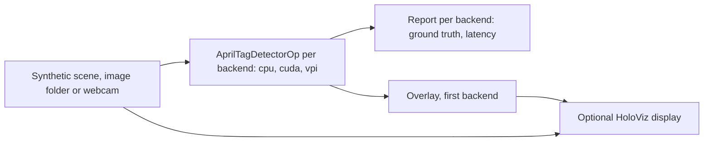

# AprilTag Detection

This application detects [AprilTags](https://april.eecs.umich.edu/software/apriltag) and estimates
their 6-DoF poses. Its core is one reusable Holoscan SDK 5 operator, `AprilTagDetectorOp`: an image
in, the tags it contains out, on a choice of backends: the AprilTag 3 library on the CPU, a CUDA
pipeline on the GPU, or NVIDIA VPI on the PVA of Jetson Orin and Thor. One source fans out to a
detector per selected backend, so backends can be compared on identical frames; with the synthetic
source, every detection is checked against the scene's ground truth.



## Backends

| Backend | Detection runs on | Notes |
| --- | --- | --- |
| `cpu` | CPU | The AprilTag 3 reference detector, with its default of one thread. |
| `cuda` | GPU | Every stage on the GPU; only the final detections are copied to the host. |
| `vpi` | PVA, or CPU | NVIDIA VPI 4's detector: on the PVA where there is one and the image suits it, otherwise on the CPU. x86_64 hosts have no PVA. |

Every backend accepts MONO8, RGB8, BGR8, RGBA8 and BGRA8 images, in host or CUDA device memory, and
every AprilTag 3 family (`tag36h11`, `tag25h9`, `tag16h5`, `tag36h10`, `tagStandard41h12`,
`tagStandard52h13`, `tagCircle21h7`, `tagCircle49h12`, `tagCustom48h12`). Poses are estimated on the
host from the detected corners, the same way for every backend. `--decimate`, `--refine-edges` and
`--sharpening` tune `cpu` and `cuda`; VPI ignores them. `--max-hamming 2` is refused for the 48-,
49- and 52-bit families, whose decode tables would take gigabytes. The PVA takes image sides from
256 to 4096 pixels, except one past a multiple of 128. `vpi` is compiled when VPI 4 is installed,
as the application's [Dockerfile](Dockerfile) does.

### Where the image goes

| Backend | Host image | CUDA device image |
| --- | --- | --- |
| `cpu`, `vpi` on the CPU | Read in place (color is converted to gray on the CPU). | Gray copied to the host. |
| `cuda` | Gray copied to the GPU. | Read in place (color is converted to gray on the GPU); no copy. |
| `vpi` on the PVA | Gray copied into a VPI image. | Gray copied into a VPI image on the GPU. |

## Requirements

- Linux on x86_64 or aarch64 with an NVIDIA GPU.
- Holoscan SDK 5.0 (Core and Sensor I/O; Visualization for the display; Testing for
  `holoscan test`), CMake 4.0+, a C++20 compiler and the CUDA toolkit.
- [AprilTag 3](https://github.com/AprilRobotics/apriltag) 3.4 or later: an installed copy, or
  release 3.4.5 downloaded at configure time and checked against its SHA-256.
- Optional: NVIDIA VPI 4 (`vpi4-dev`) for the `vpi` backend.
- For the `camera` mode: a V4L2 webcam offering YUYV, and a display.

The [Dockerfile](Dockerfile) adds VPI 4 to the SDK image from NVIDIA's Jetson apt repository, a
package source outside the SDK image. It accepts that repository's signing key only with a pinned
fingerprint and installs pinned package versions; see the repository's
[threat model](../../SECURITY.md#threat-model).

## Build and run

From the repository root (add `--local` to build and run on the host, with `HOLOSCAN_SDK_ROOT` set):

```bash
export HOLOSCAN_CLI_BASE_IMAGE=nvcr.io/nvidia/clara-holoscan/holoscan:v5.0.0-cuda13
holoscan run apriltag_detection          # synthetic
holoscan run apriltag_detection ci
```

| Mode | Behavior |
| --- | --- |
| `synthetic` (default) | 300 rendered frames through every compiled backend, checked against ground truth; shows the first backend's detections when a display is available. |
| `images` | Detects tags in the PGM/PPM images in `data/apriltag_detection`. |
| `camera` | A live webcam with the detections drawn over it. |
| `ci` | 30 frames through every compiled backend, headless, checked against ground truth. |

Each run prints a line per backend with its frame and tag counts, its detection latency (mean,
median, 95th percentile, maximum) and, for synthetic input, its ground-truth errors, then a verdict:
`PASS`, `FAIL`, or `STOPPED` when an interrupt or a closed window ends the run early. It exits 0 on
`PASS` (and on a stopped live camera run), 1 otherwise, and 2 for invalid options. `--run-args`
appends options, for example `--run-args='--backend cuda,vpi --family tagStandard41h12'`; `--help`
lists them. The display draws each tag's axes as arrows, X red, Y green and Z blue, in the tag frame
(x right and y down as printed, z into the tag), or X and Y in the image plane without a pose; a
dark blue label gives the id and, with a pose, the distance.

### Webcam

Print a `tag36h11` tag (for example from the AprilTag
[image repository](https://github.com/AprilRobotics/apriltag-imgs)), allow the container to open a
window with `xhost +local:`, run `holoscan run apriltag_detection camera`, and hold the tag up to the
camera. The camera must offer YUYV at the requested size (default 640x480, or for example
`--run-args='--width 1280 --height 720'`); otherwise the run stops with the sizes it offers. To use
another camera, list them with `v4l2-ctl --list-devices` and pass one with `--device /dev/videoN`.
The run lasts until Ctrl+C or the window is closed, and records nothing.

With the camera's intrinsics and the tag's size, poses and distances are shown too. The size is the
side of the square the detector finds: the black border for `tag36h11`, and five of the nine cells
across for `tagStandard41h12` (40 mm on a tag printed 72 mm wide):

```bash
holoscan run apriltag_detection camera --run-args='--family tagStandard41h12 \
  --fx 600 --fy 600 --cx 319.5 --cy 239.5 --tag-size 0.040'
```

### Your own images

Convert frames to binary PGM or PPM, for example
`ffmpeg -i video.mp4 data/apriltag_detection/%06d.pgm`, and pass the camera's intrinsics (pixel
centers at integer coordinates, as in OpenCV and ROS `CameraInfo`) and the tag's size to also
estimate poses:

```bash
holoscan run apriltag_detection images \
  --run-args='--fx 910.5 --fy 910.5 --cx 639.5 --cy 359.5 --tag-size 0.08'
```

## Output

`AprilTagDetectorOp` emits one `AprilTagDetections` message per image, defined by
[apriltag_detections.fbs](cpp/operators/apriltag_detections.fbs): the frame number, image size,
backend, family and detection time, and per tag its id, corrected bits, decision margin, center,
corners and, when the intrinsics are known, its pose. Corners start at the tag's bottom-left and go
counter-clockwise as printed, as in AprilTag 3. Poses place the tag in the camera frame (x right,
y down, z forward); the tag's x is right and y down as printed, z into the tag.

## Use the operator in your graph

```cpp
#include "operators/apriltag_detector_op.hpp"

auto detector = graph.op<tag_detection::AprilTagDetectorOp>(
    "apriltag", tag_detection::AprilTagDetectorConfig{
                    .backend = tag_detection::Backend::kCuda,
                    .options = {.family = "tag36h11"},
                    .intrinsics = tag_detection::CameraIntrinsics{910.5, 910.5, 639.5, 359.5},
                    .tag_size = 0.08});
graph.add_flow(camera->image, detector->image);                // Input<schema::ImageT>
graph.add_flow(detector->detections, consumer->detections);    // Output<AprilTagDetectionsT>
```

Build inside this tree, or copy the operator files into your project. The backends have no Holoscan
dependency (`tag_detection::create_backend`).

## Performance

Medians of the operator's time from receiving the image to having detections and poses, for 300
synthetic 1280x720 frames with four `tag36h11` tags, one backend at a time
(`--run-args='--backend cuda --count 300 --period-ms 1 --display false [--device-input true]'`), in
the application's container image (SDK 5.0.0, CUDA 13.2, VPI 4.0.5) on an RTX 5090 with an AMD
Ryzen 9 9950X3D. Every backend found all 1200 tags with no false detections.

| Backend | Host RGB input | GPU RGB input (`--device-input true`) | Largest corner error |
| --- | --- | --- | --- |
| `cpu` (AprilTag's default, one thread) | 21.3 ms | 21.0 ms | 0.22 px |
| `cuda` | 5.3 ms | 4.8 ms | 0.22 px |
| `vpi` (VPI's CPU path on x86_64) | 5.7 ms | 5.4 ms | 0.40 px |

## Tests

```bash
holoscan test apriltag_detection --no-xvfb
```

The suite checks every compiled backend against ground truth for several families, from host and
GPU memory; the CUDA backend against the CPU reference on tags cut by the image edge; the operators
through the SDK's operator test harness; the application on synthetic frames and image folders; the
display graph's compilation; the exit status of stopped, failed and invalid runs; and the webcam's
YUYV conversion and the overlay's axis drawing, which need no SDK and also run on hosted CI. Nothing
needs data or a camera.

Validated on x86_64 with SDK 5.0.0: on an RTX 5090 with CUDA 13.2 and VPI 4.0.5 (`cpu`, `cuda`, and
`vpi` on the CPU), and on an RTX 5080 Laptop GPU with CUDA 13.0, including the live webcam path with
a USB webcam. The PVA path and aarch64 have not been run yet; nor has VPI's PVA detector been
checked with every family.

## Licenses

The application is licensed under Apache 2.0. The AprilTag 3 library, built from source by default
and linked into the executable, is
[BSD-2-Clause](https://github.com/AprilRobotics/apriltag/blob/master/LICENSE.md); its notice is
installed as `share/apriltag_detection/licenses/apriltag-LICENSE.md`. Tags printed from the AprilTag
image repository are under its
[BSD-2-Clause license](https://github.com/AprilRobotics/apriltag-imgs/blob/master/LICENSE). VPI is
distributed by NVIDIA under its own terms, installed with the package as
`/opt/nvidia/vpi4/doc/VPI_EULA.txt`.
