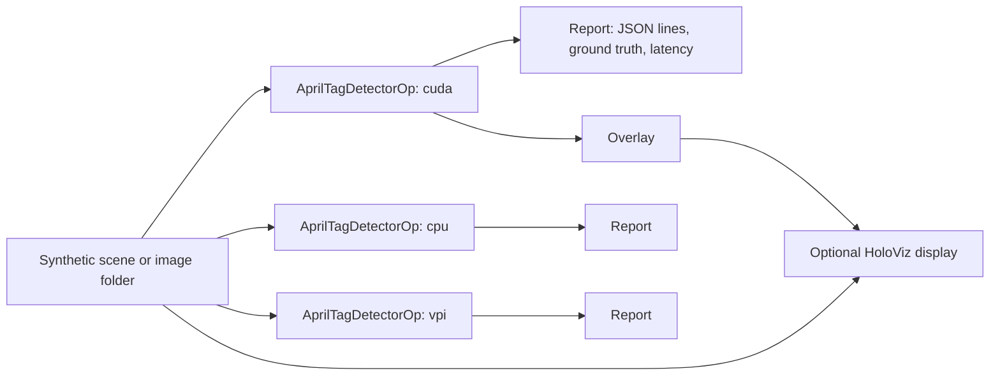

# AprilTag Detection

This application detects [AprilTags](https://april.eecs.umich.edu/software/apriltag)
and estimates their 6-DoF poses. Its core is one reusable Holoscan SDK 5
operator, `AprilTagDetectorOp`: an image in, the tags it contains out. The
operator runs on a choice of backends — the AprilTag 3 library on the CPU, a
CUDA pipeline on the GPU, or NVIDIA VPI on the PVA of Jetson Orin and Thor — so
a robot can keep detection off whichever processor its other work needs.



The application fans one source out to a detector per selected backend, so
backends can be compared on identical frames. With the synthetic source, every
detection is checked against the scene's ground truth.

## Backends

| Backend | Detection runs on | Notes |
| --- | --- | --- |
| `cpu` | CPU | The AprilTag 3 reference detector; `--threads` workers. |
| `cuda` | GPU, then CPU | Decimation, adaptive threshold, connected components, edge clustering, angular sorting and corner candidates on the GPU; choosing each quad's corners, edge refinement and decoding on the CPU. |
| `vpi` | PVA, or CPU without one | NVIDIA VPI 4's detector. Jetson Orin and Thor have a PVA; x86_64 hosts do not. Images the PVA cannot take run on VPI's CPU path. |
| `vpi-pva` | PVA | Fails to start where there is no PVA. |
| `vpi-cpu` | CPU | VPI's CPU implementation. |

Every backend accepts MONO8, RGB8, BGR8, RGBA8 and BGRA8 images, in host or
CUDA device memory, and every AprilTag 3 family (`tag36h11`, `tag25h9`,
`tag16h5`, `tag36h10`, `tagStandard41h12`, `tagStandard52h13`, `tagCircle21h7`,
`tagCircle49h12`, `tagCustom48h12`). Poses are estimated the same way for every
backend, from the detected corners, with the AprilTag 3 library's solver.
`--decimate`, `--refine-edges`, `--sharpening` and `--threads` tune the `cpu`
and `cuda` backends; VPI's detector has no such settings and ignores them.
`--max-hamming 2` is refused for the 48-, 49- and 52-bit families, whose decode
tables would take gigabytes. The PVA accepts image sides from 256 to 4096
pixels, except one pixel past a multiple of 128. Reports and messages name the
hardware VPI used, `vpi-pva` or `vpi-cpu`.

The `vpi` backends are compiled when VPI 4 is installed; the application's
[Dockerfile](Dockerfile) installs it. Without VPI, the build has `cpu` and
`cuda` only.

## Dependencies

- Linux on x86_64 or aarch64 with an NVIDIA GPU and a compatible driver.
- Holoscan SDK 5.0 Core and Sensor I/O, and Visualization for display builds.
- CMake 4.0+, a C++20 compiler and the CUDA toolkit.
- [AprilTag 3](https://github.com/AprilRobotics/apriltag) 3.4 or later. CMake
  uses an installed copy if it finds one; otherwise it downloads release 3.4.5
  from GitHub at configure time and verifies its SHA-256, so a build machine
  without network access needs an installed copy.
- Optional: NVIDIA VPI 4 (`vpi4-dev`), for the `vpi` backends.
- Python 3.12–3.14 and the CLI pinned in the repository's
  [requirements.txt](../../requirements.txt) for repository workflows.

The application needs no models. The `images` mode reads your own images (see
[Your own images](#your-own-images)); every other mode renders its frames.

## Build and run

The application's [Dockerfile](Dockerfile) adds NVIDIA VPI 4 to the SDK image
from NVIDIA's Jetson apt repository, a package source outside the SDK image. The
build accepts that repository's signing key only with a pinned fingerprint and
installs pinned VPI package versions; review both before changing
`VPI_REPOSITORY_RELEASE` or `VPI_VERSION`. See the repository's
[threat model](../../SECURITY.md#threat-model).

From the repository root, choose a development image matching the SDK:

```bash
export HOLOSCAN_CLI_BASE_IMAGE=nvcr.io/nvidia/clara-holoscan/holoscan:v5.0.0-cuda13
holoscan run apriltag_detection
holoscan run apriltag_detection benchmark
holoscan run apriltag_detection ci
```

The CLI builds the application's [Dockerfile](Dockerfile), which adds VPI 4 to
the SDK image. To build and run on the host instead, install the dependencies,
set `HOLOSCAN_SDK_ROOT` to the SDK installation and add `--local`.

| Mode | Behavior |
| --- | --- |
| `synthetic` (default) | 300 rendered frames through every compiled backend, checked against ground truth; shows the first backend's detections when a display is available. |
| `images` | Detects tags in the PGM/PPM images in `data/apriltag_detection`. |
| `benchmark` | Every compiled backend side by side on 300 frames, without a display. |
| `ci` | 30 frames through every compiled backend, headless, checked against ground truth. |

Each run prints a line per backend with its frame and tag counts, its detection
latency (mean, median, 95th percentile and maximum), and, for synthetic input,
its ground-truth errors, then a `verdict`: `PASS`, `FAIL`, or `STOPPED` when
an interrupt or a closed window ends the run early. It exits nonzero unless the
verdict is `PASS`. `--compile-only true` builds and checks the graph without
running it.
`--run-args` appends options to the mode's command, for example
`--run-args='--backend cuda,vpi --family tagStandard41h12'`. Run the executable
with `--help` for every option.

### Your own images

Any image tool can convert frames to the binary PGM or PPM files the image
source reads, for example:

```bash
mkdir -p data/apriltag_detection
ffmpeg -i video.mp4 data/apriltag_detection/%06d.pgm
```

Pass the camera's intrinsics and the tag's size (the width of its black border,
in meters) to also estimate poses:

```bash
holoscan run apriltag_detection images \
  --run-args='--fx 910.5 --fy 910.5 --cx 639.5 --cy 359.5 --tag-size 0.08 --output-dir /tmp'
```

Intrinsics place pixel centers at integer coordinates, as OpenCV and ROS
`CameraInfo` do. `--output-dir` writes `<backend>.jsonl`, one JSON object per
frame with each tag's id, corners, decision margin and pose.

## Output

`AprilTagDetectorOp` emits one `AprilTagDetections` message per image, defined
by the FlatBuffers schema [apriltag_detections.fbs](cpp/operators/apriltag_detections.fbs):
the frame number, image size, backend, family and detection time, and for each
tag its id, corrected bits, decision margin, center and corners, and, when the
intrinsics are known, its pose. Corners start at the tag's bottom-left and go
counter-clockwise as the tag is printed, as in the AprilTag 3 library. Poses
place the tag frame in the camera frame: the camera's x right, y down and z
forward; the tag's x right and y down as printed, and z into the tag.

## Use the operator in your graph

The operator takes its configuration at construction:

```cpp
#include "operators/apriltag_detector_op.hpp"

auto detector = graph.op<tag_detection::AprilTagDetectorOp>(
    "apriltag", tag_detection::AprilTagDetectorConfig{
                    .backend = tag_detection::Backend::kCuda,
                    .options = {.family = "tag36h11"},
                    .intrinsics = tag_detection::CameraIntrinsics{910.5, 910.5, 639.5, 359.5},
                    .tag_size = 0.08});
graph.add_flow(camera->image, detector->image);                // Input<schema::ImageT>
graph.add_flow(detector->detections, consumer->detections);    // Output<AprilTagDetectionsT>
```

Link `apriltag_detection_operators`. The backends themselves are in
`apriltag_detection_core`, which has no Holoscan dependency and can be used on
its own through `tag_detection::create_backend`.

## Performance

Measured in the application's container image (SDK 5.0.0, CUDA 13.2, VPI
4.0.5) on an RTX 5090 with an AMD Ryzen 9 9950X3D: 300 synthetic 1280x720 frames
with four `tag36h11` tags, one backend at a time
(`--backend <name> --count 300 --period-ms 1 --display false`). Times are the
operator's median, from receiving the image to having detections and poses.

| Backend | Host RGB input | GPU RGB input (`--device-input true`) | Largest corner error |
| --- | --- | --- | --- |
| `cpu`, 1 thread | 21.3 ms | 21.0 ms | 0.22 px |
| `cpu`, 8 threads | 6.8 ms | — | 0.22 px |
| `cuda` | 5.2 ms | 4.7 ms | 0.22 px |
| `vpi` (VPI's CPU path on x86_64) | 5.7 ms | 5.4 ms | 0.40 px |

Every backend found all 1200 tags with no false detections. On tags cut off by
the image edge, `cuda` finds every tag the reference finds and more, with no
false detections (see `tests/backend_accuracy_test.cpp`).

## Standalone build

Build and run the executable without the CLI:

```bash
cmake -S applications/apriltag_detection -B build/apriltag-standalone \
  -Dholoscan_ROOT="$HOLOSCAN_SDK_ROOT" -DCMAKE_CUDA_ARCHITECTURES=native \
  -DBUILD_TESTING=OFF
cmake --build build/apriltag-standalone --parallel
./build/apriltag-standalone/apriltag_detection --backend all --count 30 --display false
```

`-DBUILD_TESTING=OFF` leaves out the tests, which need the SDK's testing
component. `-DAPRILTAG_DETECTION_ENABLE_VISUALIZATION=OFF` removes the display
dependency, and `-DAPRILTAG_DETECTION_WITH_VPI=OFF` leaves out the VPI backends.

## Tests

```bash
holoscan test apriltag_detection --no-xvfb
```

The suite checks every compiled backend against the synthetic scene's ground
truth for several families, from host and GPU memory; the operators on their
own through the SDK's operator test harness; tags cut off by the image edge; the
application on synthetic frames and on gray and color image folders; the
compilation of the display graphs; the exit status and verdict of a stopped
run, a failed run, and a run under a profiler-like preloaded library; and the
rejection of invalid options. All of it needs the SDK and a GPU; none of it
needs data. Add `--cmake-options='-DAPRILTAG_DETECTION_TEST_DISPLAY=ON'` to also
render the overlay offscreen through HoloViz, which needs Vulkan in the test
environment (`NVIDIA_DRIVER_CAPABILITIES=all` in a container).

Validated on x86_64 (RTX 5090) with SDK 5.0.0, CUDA 13.2 and VPI 4.0.5, with
`cpu`, `cuda` and `vpi` on the CPU. This application's PVA path and aarch64
builds have not been run yet; nor has VPI's PVA detector been checked with
every family.

## Licenses

The application is licensed under Apache 2.0. The AprilTag 3 library, built
from source by default and linked into the executable, is BSD-2-Clause; its
notice is installed as `share/apriltag_detection/licenses/apriltag-LICENSE.md`.
VPI is distributed by NVIDIA under its own terms, installed with the package as
`/opt/nvidia/vpi4/doc/VPI_EULA.txt`.
