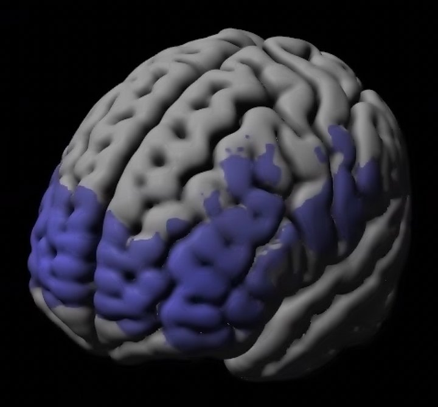
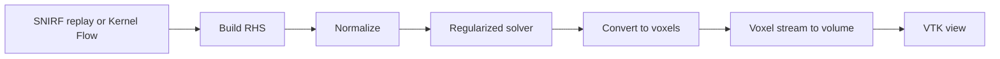

# Kernel Flow BCI Real-Time Visualization

This application reconstructs brain activity from [Kernel Flow](https://www.kernel.com/)
functional near-infrared spectroscopy (fNIRS) data and shows it on an interactive 3D
brain. It replays a recorded SNIRF file or streams from a Kernel Flow headset, solves the
inverse problem on the GPU with CuPy, and renders the oxygenated-hemoglobin changes on
an anatomical brain model with [VTK](https://vtk.org/). Every operator is a Holoscan SDK 5.x
Python operator.



## Overview

This application demonstrates real-time source reconstruction and 3D visualization for
brain-computer interface (BCI) pipelines built with NVIDIA Holoscan. The Holoscan 4.x
version was developed with Kernel and tested on an NVIDIA Jetson Thor paired with a Kernel
Flow 2 headset. A recorded dataset and a replayer let you build and experiment with
visualization and classification pipelines without access to the hardware.

The application processes streaming
[moments from the distribution of time-of-flight histograms](https://doi.org/10.1117/1.NPh.10.1.013504),
read from a [shared near-infrared spectroscopy format (SNIRF)](https://github.com/fNIRS/snirf)
recording. It combines the moments with the sensors' spatial geometry and an average
anatomical head model to produce source-reconstructed outputs similar to
[previously published work](https://direct.mit.edu/imag/article/doi/10.1162/imag_a_00475/127769/A-Compact-Time-Domain-Diffuse-Optical-Tomography).

## Background

Kernel Flow is a multimodal non-invasive brain measurement system. It combines the
relatively high resolution of time-domain functional near-infrared spectroscopy (TD-fNIRS)
with the fast temporal resolution of electroencephalography (EEG) in a compact and
scalable form factor that enables a new class of non-invasive BCI applications.

The differentiating technology behind Kernel Flow is its time-resolved detectors and
high-speed laser drivers. Short (~100 ps) pulses of near-infrared laser light (690 nm and
905 nm) are emitted into the user's head with a repetition rate of 20 MHz. The photons in
these pulses scatter through the scalp, skull, and cerebrospinal fluid before reaching the
brain and then scattering back out. When the photons emerge from the scalp,
single-photon-sensitive detectors timestamp exactly how long each photon took to traverse
the head. That time is proportional to the path length the photon traveled and the average
depth it reached.

This simulation shows the relationship between photon scattering paths (black lines) and
the measured time of flight (blue sections):


Later times correspond to photons that traveled farther into the tissue. Kernel Flow
timestamps over 10 billion individual photons each second; after compression, it produces
about 1 GB of data per minute.

As the photons scatter through the tissue, many are absorbed by cells and molecules. The
wavelengths used are particularly sensitive to hemoglobin in its two states,
oxyhemoglobin and deoxyhemoglobin. This makes it possible to follow the locations in the
brain that are demanding and consuming oxygen, an indirect measure of neuronal activity.
The same biophysical principles are behind the pulse oximeters in smart watches and
finger-clip sensors. For more detail on the biophysics, see
[this review article](https://www.mdpi.com/2076-3417/9/8/1612).

The Kernel Flow headset combines 120 laser sources and 240 custom sensors to collect over
3000 measurement paths that criss-cross the head, at a frame rate of 4.75 Hz:


Each measurement path is a "channel", and the measurement is made in sensor space, from
the perspective of the detector. For a more anatomical representation, the sensor-space
data is commonly transformed into source space, where the changes in hemoglobin
concentration likely occurred in the brain, by solving an inverse problem known as source
reconstruction. This inverse problem requires computationally expensive but highly
parallelizable modeling. This application solves it on the GPU in real time, at the native
4.75 Hz frame rate of Kernel Flow, and renders the result as a 3D volume.

## Dependencies

- Linux on x86_64 or aarch64 with an NVIDIA GPU and a driver supporting CUDA 13.
- Python 3.12 and the packages in [requirements.txt](requirements.txt), including the
  Holoscan SDK 5.x Python Core (`holoscan-core-cu13`), CuPy, and VTK.
- An X display for the interactive window. Headless runs render offscreen with EGL.
- A Kernel Flow data source: a recorded SNIRF file (see
  [Prepare the data](#prepare-the-data)) or a headset with Kortex (see
  [Stream from a Kernel Flow headset](#stream-from-a-kernel-flow-headset)).

The application [Dockerfile](Dockerfile) installs these on a CUDA runtime image; the
Holoscan CLI uses it for container builds and runs.

## Prepare the data

`holoscan build` and `holoscan run` download the data into `data/bci_visualization`
the first time (except in the `ci` mode). Pass
`--cmake-options="-DHOLOHUB_DOWNLOAD_DATASETS=OFF"` to skip the download. To prepare it
by hand instead, from the repository root:

```bash
python3 applications/bci_visualization/prepare_data.py --output data/bci_visualization
```

This downloads a pinned revision of the
[Kernel sample dataset](https://huggingface.co/datasets/KernelCo/holohub_bci_visualization):
the SNIRF recording (about 500 MB), the anatomy mask, and the reconstruction assets for
the `flow_2` headset, whose channel map covers every channel in this recording. Its
Jacobian is 14.25 GB and is loaded into GPU memory, so the GPU needs more than 14.25 GB free.

The prepared dataset occupies about 14.8 GB on disk. Allow roughly 17–20 minutes for
the initial download, based on an observed transfer; actual time depends on network
throughput. Replacing an existing dataset with `--force` can temporarily require about
29 GB because each new file is downloaded before replacing the old copy.

The dataset contains:

- **`data.snirf`**: the recorded brain activity measurements.
- **`anatomy_labels_high_res.nii.gz`**: the brain tissue segmentation (skin, skull, CSF,
  gray matter, white matter).
- **Reconstruction assets** for one headset: the precomputed Jacobian, the channel map,
  and the voxel information.

The prepared folder has this structure:

```text
data/bci_visualization/
├── anatomy_labels_high_res.nii.gz      # Brain segmentation
├── data.snirf                          # SNIRF brain activity recording
├── extinction_coefficients_mua.csv     # Absorption coefficients for HbO/HbR
├── flow_channel_map.json               # Source-detector channel mapping
├── flow_mega_jacobian.npy              # Precomputed sensitivity matrix (channels → voxels)
└── voxel_info/                         # Voxel geometry and optical properties
    ├── affine.npy                      # 4x4 affine transformation matrix
    ├── idxs_significant_voxels.npy     # Indices of voxels with sufficient sensitivity
    ├── ijk.npy                         # Voxel coordinates in volume space
    ├── mua.npy                         # Absorption coefficient per voxel
    ├── musp.npy                        # Reduced scattering coefficient per voxel
    ├── resolution.npy                  # Voxel resolution (mm)
    ├── wavelengths.npy                 # Measurement wavelengths (690 nm, 905 nm)
    └── xyz.npy                         # Voxel coordinates in anatomical space (mm)
```

Pick another headset's assets with `--headset` when replaying a matching recording.
Each file is checked against the SHA-256 checksums in `dataset_checksums.json`: files that
match are kept, and missing or mismatched files are downloaded again. Pass `--force` to
download every file. More recordings are available on
[OpenNeuro](https://openneuro.org/datasets/ds006545).

## Run

```bash
holoscan run bci_visualization
```

Drag with the left mouse button to rotate, the right button or the wheel to zoom, and the
middle button to pan. Close the window, or press `q`, to stop. The application also exits
when the recording ends.

The `headless` mode renders offscreen and writes the last frame to
`bci_visualization.png`. The `ci` mode replays a small generated dataset at the recording
pace, so it needs a GPU but no data or display:

```bash
holoscan run bci_visualization headless
holoscan run bci_visualization ci
```

To run directly with Python, pass the data directory:

```bash
python3 applications/bci_visualization/python/bci_visualization.py --data data/bci_visualization
```

By default the replay runs as fast as the pipeline reconstructs frames. Add
`--replay-rate realtime` to follow the recording's timestamps (4.75 Hz for Kernel Flow).
`--frames N` stops after N samples. Run with `--help` for the other options.

## Stream from a Kernel Flow headset

The `live` mode streams moments from a Flow headset through Kernel's Kortex service and
the [Kernel SDK](https://pypi.org/project/kernel-sdk/) (`kernel-sdk`, installed with the
other requirements). Prepare the data for your headset with `prepare_data.py --headset`,
start Kortex on the same machine, and run:

```bash
holoscan run bci_visualization live
```

The `live` mode mounts Kortex's `/etc/kernel.com/kortex.json` read-only into the
container; if the file is missing, Docker refuses to start the container.

The application keeps the channels that are valid in the first sample, and stops with an
error that lists unmapped channels if the headset's assets don't match. Samples are shown
as they arrive; if reconstruction falls behind, the oldest waiting samples are dropped.
The run continues until you close the window, or for `--frames N` samples.
Headless device simulation also exits when its recording ends. The Kernel SDK
reports errors to Kernel through Sentry unless `SENTRY_DSN_SDK` is empty, so the
application sets it empty unless you set it yourself.

To try the live path without a headset, `--source kernel --simulate-device` streams the
recording through the same code at its recorded rate, and `--synthetic` does the same on
generated data:

```bash
python3 applications/bci_visualization/python/bci_visualization.py \
  --synthetic --source kernel --simulate-device
```

## Pipeline



The reconstruction steps transform sensor-space measurements into 3D brain activity maps:

1. **Stream** (`StreamOperator`) reads the SNIRF recording or the headset and emits the
   time-of-flight moments of each sample with its channel layout.
2. **Build RHS** builds the right-hand side of the inverse problem from the moments,
   using the channel map to select the matching Jacobian rows.
3. **Normalize** scales the moments and the Jacobian by fixed upper bounds.
4. **Regularized solver** solves the inverse problem on the GPU.
5. **Convert to voxels** maps the solution to voxel coordinates and converts it to
   oxygenated (HbO) and deoxygenated (HbR) hemoglobin changes.
6. **Voxel stream to volume** resamples the HbO changes onto the anatomy mask grid and
   scales them for display with a running minimum and maximum.

**VTK view** runs on its own 30 Hz clock and takes the newest volume, so the window
stays responsive and interactive between reconstructed frames.

## Visualization

By default the view colors a smoothed cortex surface with the activity averaged over the
first 6 mm below it (`--surface-depth-mm`). Blue shows decreases, red shows increases, and
gray shows baseline.

The surface view also darkens sulci, like the 4.x path-traced shading;
`--no-surface-texture` turns that off.

`--view volume` ray casts the whole volume instead, as the 4.x application did. It uses
VTK's GPU ray-cast mapper, limited to gray matter
(label 3) and white matter (label 4) of the anatomy mask. The mask's other labels are
skin (0), skull (1), CSF (2) and air (5). The transfer function follows the three layers
of the 4.x application, over the displayed density range (−100 to 100 by default):

- **Blue, opaque** (lowest 40%): decreased oxygenated hemoglobin, from bright to dark
  blue.
- **White, semi-transparent** (40–60%): baseline tissue with no significant change.
- **Red, opaque** (highest 40%): increased oxygenated hemoglobin, from dark to bright red.

## Tests

```bash
holoscan test bci_visualization
```

The data preparation test needs only Python. The other tests need the packages in
`requirements.txt`; the solver and end-to-end tests also need a GPU.

## Changes from the Holoscan 4.x application

- The ClaraViz volume renderer and HoloViz window are replaced by a VTK operator that
  owns its window and mouse interaction. VTK reads host memory, so the surface view
  copies only the surface colors from the GPU for each displayed volume, while
  `--view volume` copies the whole volume for VTK's GPU ray-cast volume mapper.
- The rendering uses the 4.x colors and visible anatomy regions, without ClaraViz's
  path-traced lighting.
functional near-infrared spectroscopy (fNIRS) data and shows it on an interactive 3D
brain. It replays a recorded SNIRF file or streams from a Kernel Flow headset, solves the
inverse problem on the GPU with CuPy, and renders the oxygenated-hemoglobin changes on

The render clock drains a depth-one queue of completed volumes. Input timestamps
remain intact; slow reconstruction or initial scene setup does not expire the final frame.
