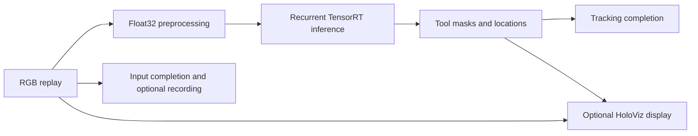

# Endoscopy Tool Tracking

This application replays surgical video and tracks seven tool classes using the
CAMMA convolutional LSTM model. It uses Holoscan SDK 5.x typed ports and
compose/compile/run APIs. All custom operators are in this application directory.



The initial migration includes C++ file replay, visualization, and optional input
recording. Python, capture-card integrations, alternative renderers, shader
variants, and GXF recording formats are outside this first application.

## Dependencies

- Linux on x86_64 or aarch64 with an NVIDIA GPU and a compatible driver.
- Holoscan SDK 5.x Core; use the `main-5x` SDK installation supplied for this work.
- Holoscan Visualization for display builds, exporting
  `holoscan::visualization::op_holoviz` and `<holoscan/visualization/holoviz_op.hpp>`.
- CMake 4.0+, a C++20 compiler, CUDA toolkit, and TensorRT 10 development libraries
  (`nvinfer`, `nvinfer_plugin`, `nvonnxparser`).
- Python 3.11–3.13 and the CLI pinned in the repository's
  [requirements.txt](../../requirements.txt) for repository workflows.
- FFmpeg for the one-time video conversion.

The application uses a small model-specific inference operator because its
recurrent cell/hidden states must persist between frames. The SDK supplies Core
and Visualization. HoloViz accepts the original RGB tensor directly.

## Prepare the sample

From the repository root:

```bash
python3 applications/endoscopy_tool_tracking/prepare_data.py \
  --output data/endoscopy --frames 300
```

This downloads the pinned
[NGC endoscopy sample](https://catalog.ngc.nvidia.com/orgs/nvidia/teams/clara-holoscan/resources/holoscan_endoscopy_sample_data)
(version `20230222`), extracts the ONNX model and H.264 input, and converts the
video to contiguous 854×480 RGB24. The default limit is 300 frames (about 369 MB).
`--frames 0` converts the whole clip. Use `--archive /path/to/sample.zip` for an
existing download and `--force` to replace prepared assets or change the frame
limit. Existing valid assets are reused by default. A failed conversion leaves
previously prepared assets intact.

The model and sample video are provided by the Research Group CAMMA, IHU
Strasbourg, and the University of Strasbourg. Their terms are provided with the
NGC resource; they are downloaded separately from this source repository.

## Build and run

For an installed SDK:

```bash
export HOLOSCAN_SDK_ROOT=/path/to/holoscan/install
holoscan run endoscopy_tool_tracking headless --local --run-args='--count 30'
```

To visualize, use an SDK installation with Visualization and a reachable X11 or
Wayland display:

```bash
holoscan run endoscopy_tool_tracking replay --local --run-args='--count 300 --display true'
```

For a data-free replay check:

```bash
holoscan run endoscopy_tool_tracking ci --local
```

`ci` processes ten synthetic frames with inference explicitly disabled. This
mode implements the [shared CI contract](../../docs/ci.md); hosted CI validates
its build/run commands with dry runs.

Real tracking is enabled by default; a missing model is an error. TensorRT builds an
engine on first use. The cache is keyed by model contents, GPU, TensorRT version,
precision, and workspace settings. Invalid engines are rejected and rebuilt.

`--count 0` processes the entire prepared video once. `--repeat true` permits a
larger explicit count than the available video. Replay preserves order and applies
backpressure through inference. Completion waits for input consumption and both
tracking outputs; the optional display consumes the latest available frames.

Record the original input into a new directory:

```bash
holoscan run endoscopy_tool_tracking headless --local \
  --run-args='--count 30 --record-dir /tmp/endoscopy-recording'
```

The output is `input.rgb`; existing recordings are never overwritten. Recording
is disabled unless requested. Run the executable with `--help` for model/cache
paths, replay timing, dimensions for synthetic tests, and timeout settings.

## Standalone build

This application also builds directly without the repository CMake entry point:

```bash
cmake -S applications/endoscopy_tool_tracking -B build/endoscopy-standalone \
  -Dholoscan_ROOT="$HOLOSCAN_SDK_ROOT" \
  -DCMAKE_CUDA_ARCHITECTURES=native \
  -DENDOSCOPY_ENABLE_VISUALIZATION=OFF \
  -DENDOSCOPY_DATA_DIR="$PWD/data/endoscopy"
cmake --build build/endoscopy-standalone --parallel
ctest --test-dir build/endoscopy-standalone --output-on-failure
```

Choose explicit CUDA architectures when building for other GPUs. Setting
`ENDOSCOPY_ENABLE_VISUALIZATION=OFF` removes the display dependency entirely.

## Tests

The wheel supplies the repository's CTest driver:

```bash
holoscan test endoscopy_tool_tracking --local --no-xvfb \
  --cmake-options="-DENDOSCOPY_ENABLE_VISUALIZATION=OFF;-DENDOSCOPY_DATA_DIR=$PWD/data/endoscopy"
```

The suite covers invalid arguments, truncated RGB streams, repeated replay,
recording byte fidelity, preservation of input files, data-preparation failures,
cache invalidation, malformed TensorRT engines, and CUDA mask composition. When
`ENDOSCOPY_DATA_DIR` is set, the real model test creates a fresh engine, reuses it,
and verifies recovery from a corrupt cache. That integration test requires at
least three prepared frames. GPU tests require CUDA even in a headless build.

Mask composition is deterministic and uses straight alpha for current HoloViz.
It preserves tool thresholds, palette, and coordinates but is not expected to be
pixel-identical to the older HoloHub premultiplied overlay.

The migration was validated on aarch64 (GB10) with Holoscan Core 5.0.0,
`main-5x` Visualization at `8b7416af9`, CUDA 13.0, and TensorRT 10.16.1. Both
headless inference and HoloViz rendering under Xvfb completed 30 real video
frames. x86_64 has not yet been exercised.
