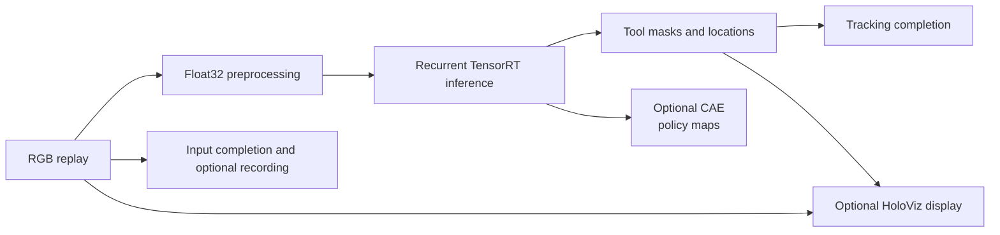
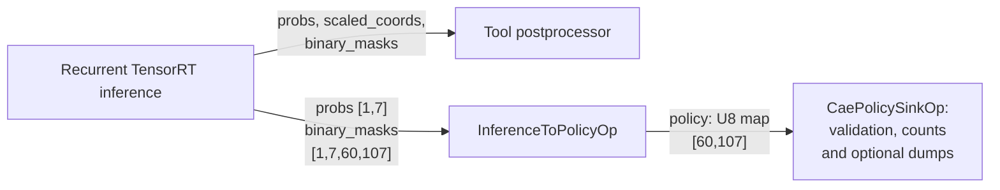

# Endoscopy Tool Tracking

This application replays surgical video and tracks seven tool classes using the
CAMMA convolutional LSTM model. It uses Holoscan SDK 5.x typed ports and
compose/compile/run APIs. All custom operators are in this application directory.



The initial migration includes C++ file replay, visualization, and optional input
recording. Python, capture-card integrations, alternative renderers, shader
variants, and GXF recording formats are outside this first application.

## Dependencies

- Linux on x86_64 or aarch64 with an NVIDIA GPU and a compatible driver.
- Holoscan SDK 5.x Core and Sensor I/O; use a `main-5x` SDK installation.
- Holoscan Visualization for display builds, exporting
  `holoscan::visualization::op_holoviz` and `<holoscan/visualization/holoviz_op.hpp>`.
- CMake 4.0+, a C++20 compiler, CUDA toolkit, and TensorRT 10 development libraries
  (`nvinfer`, `nvinfer_plugin`, `nvonnxparser`).
- Python 3.12–3.14 and the CLI pinned in the repository's
  [requirements.txt](../../requirements.txt) for repository workflows.
- FFmpeg for the one-time video conversion.

The application uses a small model-specific inference operator because its
recurrent cell/hidden states must persist between frames. The SDK supplies Core
and Visualization. HoloViz accepts the original RGB tensor directly. The C++
executable has no Python runtime dependency; Python is used by the CLI, tests,
and optional sample-preparation utility.

## Prepare the sample

Once, from the repository root, with FFmpeg installed on the host:

```bash
python3 applications/endoscopy_tool_tracking/prepare_data.py \
  --output data/endoscopy --frames 300
```

This downloads the pinned
[NGC endoscopy sample](https://catalog.ngc.nvidia.com/orgs/nvidia/teams/clara-holoscan/resources/holoscan_endoscopy_sample_data)
(version `20230222`), extracts the ONNX model and H.264 input, and converts the
video to contiguous 854×480 RGB24. The default limit is 300 frames (about 369 MB).
`--frames 0` converts the whole clip. Use `--archive /path/to/sample.zip` for an
existing download and `--force` to replace prepared assets or change the frame
limit. Existing valid assets are reused by default. A failed conversion leaves
previously prepared assets intact. Alternatively, supply an ONNX model and
RGB24 video directly. The application never downloads or converts data at runtime.

The model and sample video are provided by the Research Group CAMMA, IHU
Strasbourg, and the University of Strasbourg. Their terms are provided with the
NGC resource; they are downloaded separately from this source repository.

## Build and run

Install the repository tools as described in the repository
[Getting started](../../README.md#getting-started). Run the commands below from
the repository root.

### In a container

The CLI builds and runs in a container by default. Select the Holoscan SDK image:

```bash
export HOLOSCAN_CLI_BASE_IMAGE=nvcr.io/nvidia/clara-holoscan/holoscan:v5.0.0-cuda13
holoscan run endoscopy_tool_tracking replay
holoscan run endoscopy_tool_tracking headless
holoscan run endoscopy_tool_tracking ci
```

Add `--dryrun --verbose` to preview the image and the build and run commands.

### On the host

Install the [dependencies](#dependencies) on the host and add `--local`:

```bash
holoscan run endoscopy_tool_tracking replay --local
```

The CLI finds an SDK installed under `/usr`, such as the Debian packages, by
default. For an SDK installed elsewhere or a source build, set
`HOLOSCAN_SDK_ROOT=/path/to/holoscan/install`.

### Modes and options

Every mode launches the C++ executable directly. `replay` and `headless` use the
prepared files in `data/endoscopy`; `ci` needs no sample data.

`replay` displays when an X11 or Wayland display is available, otherwise it runs
headless. To require a window, use `--run-args='--display true'`.

`ci` processes ten synthetic frames with inference explicitly disabled. This
mode implements the [shared CI contract](../../docs/ci.md); hosted CI validates
its build/run commands with dry runs and executes the SDK-free data-preparation
tests. The configured SDK job builds and runs this mode and the C++/CUDA tests.

Real tracking is enabled by default; a missing model is an error. TensorRT builds an
engine on first use. The cache is keyed by model contents, GPU, TensorRT version,
precision, and workspace settings. Invalid engines are rejected and rebuilt.
FP32 is the default because FP16 produced NaN predictions on GB10 / TensorRT
10.16. Invalid probabilities or coordinates fail the run instead of silently
producing empty overlays.

`--count 0` processes the entire prepared video once. `--repeat true` permits a
larger explicit count than the available video. Replay preserves order and applies
backpressure through inference. Completion waits for input consumption and both
tracking outputs; the optional display consumes the latest available frames.

Record the original input into a new directory:

```bash
holoscan run endoscopy_tool_tracking headless \
  --run-args='--count 30 --record-dir /workspace/holohub/data/endoscopy-recording'
```

The output is `data/endoscopy-recording/input.rgb` on the host, preserved through
the repository mount. With `--local`, use a host path instead. Existing recordings
are never overwritten. Use `--run-args='--help'` for model/cache paths, replay
timing, dimensions for synthetic tests, and timeout settings.

## Content-adaptive encoding policy

`--cae` adds content-adaptive encoding (CAE) to the existing pipeline. The model
decides which regions matter; a separate encoder integration later turns those
decisions into encoder quality controls. The default, `--cae off`, builds the
same graph and prints the same output as before.

| Mode | Behavior |
| --- | --- |
| `off` | Default. No CAE operators are created. |
| `policy` | Requires inference. Generates one policy map per frame, validates it, counts it toward completion, and optionally dumps it. |
| `encode` | Rejected at startup. Encoding requires holoscan-multimedia Delta-QP support, which is not yet available. |



`InferenceToPolicyOp` reads the raw model outputs: FP32 probabilities `[1,7]` and
masks `[1,7,60,107]`. It never uses the colored display overlay. For each of the
60x107 mask cells it emits one codec-independent policy value:

| Value | Policy | Meaning |
| --- | --- | --- |
| 0 | `neutral` | No change |
| 1 | `protect` | Keep more quality |
| 2 | `protect_strong` | Keep much more quality |
| 3 | `deprioritize` | Spend fewer bits |
| 4 | `deprioritize_strong` | Spend many fewer bits |

A class covers a cell when its probability is at least `class_threshold` and its
mask value is at least `mask_threshold`. A covered cell takes that class's
policy; uncovered cells take `background_policy`. When several classes cover a
cell, protection wins: `protect_strong` > `protect` > `neutral` >
`deprioritize` > `deprioritize_strong`. Numeric values never imply priority. A
frame without detections produces a complete background map. The application
never chooses QP values or codec block sizes.

### Policy configuration

`--cae-policy-config FILE` selects a JSON mapping. Without it, the built-in
defaults apply. They match [`cae_policy_default.json`](cae_policy_default.json):
every tool class `neutral` and the background `deprioritize`.

```json
{
  "schema_version": 1,
  "class_threshold": 0.5,
  "mask_threshold": 0.5,
  "background_policy": "deprioritize",
  "classes": {
    "grasper": "protect",
    "bipolar": "protect_strong",
    "hook": "protect"
  }
}
```

- `schema_version` is required and must be `1`. Other fields are optional.
- Class keys are names or model class numbers in this order: `0` grasper,
  `1` bipolar, `2` hook, `3` scissors, `4` clipper, `5` irrigator,
  `6` specimen_bag. Names are case-insensitive. Unlisted classes are `neutral`.
- Policies are names or values `0`-`4`. Thresholds are in `[0, 1]`.
- Unknown fields, classes or policies, a class listed twice, malformed JSON and
  a UTF-8 byte order mark fail at startup with exit status 2.

### Policy dumps

`--cae-policy-dump DIR` writes diagnostic files to a new directory:

| File | Contents |
| --- | --- |
| `manifest.json` | Map geometry, source size, cell-to-pixel rule, policy legend and the configuration used |
| `frames.jsonl` | One line per frame: `frame_id` (processed frame number), `capture_timestamp_ns` (see [Frame identity and failures](#frame-identity-and-failures)), file name and per-policy cell counts |
| `policy_NNNNNN.pgm` | One 107x60 8-bit PGM per frame holding the raw policy values |

`DIR` must not exist yet, and its closest existing parent must be a writable
directory; both are checked at startup. A relative `DIR` is resolved against the
working directory, which is the build directory under the CLI, so prefer an
absolute path such as `/workspace/holohub/data/...`. The startup line shows the
resolved path as `dump=...`.

The PGM values are the policy numbers 0-4, so images look nearly black; scale or
colorize them to inspect. Policy column `c` covers source pixels
`floor(c*854/107)` to `floor((c+1)*854/107)`; rows use `480/60`. Dumping copies
every map to the host; leave it off when measuring performance.

```bash
holoscan run endoscopy_tool_tracking cae_policy \
  --run-args='--cae-policy-config /workspace/holohub/data/my_policy.json --cae-policy-dump /workspace/holohub/data/cae-policy'
```

A successful run prints the policy configuration at startup, then the standard
summary and one CAE line:

```text
endoscopy_tool_tracking: cae=policy class_threshold=0.5 mask_threshold=0.5 background=deprioritize classes=grasper:protect,bipolar:protect_strong,hook:protect,scissors:neutral,clipper:neutral,irrigator:neutral,specimen_bag:neutral dump=/workspace/holohub/data/cae-policy
endoscopy_tool_tracking: expected=300 consumed=300 tracked=300 inference=on verdict=PASS
endoscopy_tool_tracking: cae=policy policies=300 verdict=PASS
```

### Frame identity and failures

Every link from the replayer to the policy sink is lossless, and every stage
publishes exactly one output per input. A sample's Holoscan publication sequence
is therefore its 1-based processed frame number. This equals the source frame
number unless `--repeat true` loops the video; frame 301 of a 300-frame clip is
source frame 1. `InferenceToPolicyOp` requires the probability and mask samples
to carry the same sequence, increasing by exactly one, and publishes it as the
policy sample's `frame_id`. Its image header's `device_sequence` stays zero
because that field is reserved for a sensor's own counter. A future encoder
input will compare this `frame_id` with the frame's own identity before
submission.

The policy sample, its image header and `frames.jsonl` carry the replayed
frame's capture time. The replayer stamps each frame with its clock time. The
preprocessing and inference operators run once per input and stamp their outputs
with their activation time, which for an input-triggered activation is the
capture time of the triggering sample, so that time passes through unchanged and
`InferenceToPolicyOp` forwards it. Consecutive maps are therefore exactly one
replay period apart. Match a policy map to its video frame by `frame_id`.

The operator runs entirely on the GPU and never waits on the host. A non-finite
probability, or one outside `[0, 1]`, marks every cell of that frame with `255`.
A non-finite mask value marks its own cell with `255`. Consumers must reject any
value above `4`. The policy sink fails the run and names the frame. Layout
errors, mismatched or noncontiguous frame sequences, and output-pool exhaustion
also fail the run with the frame number.

## Tests

The CLI supplies the repository's CTest driver; `holoscan test` takes no mode.
In a container, with `HOLOSCAN_CLI_BASE_IMAGE` selected:

```bash
holoscan test endoscopy_tool_tracking --no-xvfb \
  --cmake-options='-DENDOSCOPY_ENABLE_VISUALIZATION=ON;-DENDOSCOPY_DATA_DIR=/workspace/holohub/data/endoscopy'
```

For host tests, add `--local` and set `ENDOSCOPY_DATA_DIR` to the host path.

The suite covers invalid arguments, truncated RGB streams, repeated replay,
recording byte fidelity, preservation of input files, data-preparation failures,
cache invalidation, malformed TensorRT engines, invalid model outputs, and CUDA
mask composition. CAE tests cover policy configuration parsing and errors, the
exact policy kernel, including thresholds, overlap priority, corners and invalid
values, the operator in a compiled graph, and CAE command-line validation. When
`ENDOSCOPY_DATA_DIR` is set, the real model test creates a fresh engine, reuses
it, and verifies recovery from a corrupt cache. It also runs `--cae policy` with
dumps and checks frame identity, map geometry and policy values. That test
requires at least three prepared frames. GPU tests require CUDA even in a headless build.

Mask composition is deterministic and uses straight alpha for current HoloViz.
It preserves tool thresholds, palette, and coordinates but is not expected to be
pixel-identical to the older HoloHub premultiplied overlay.

The application was validated on aarch64 (GB10) with Holoscan SDK 5.0.0 at
`main-5x` commit `e5191121d`, CUDA 13.0, and TensorRT 10.16.1. Headless inference
and HoloViz rendering under Xvfb completed 300 real video frames. x86_64 and
native Wayland have not yet been exercised.

CAE policy generation was validated on aarch64 (Jetson AGX Thor, JetPack 7.2.1,
driver 595.78) in the `nvcr.io/nvidia/clara-holoscan/holoscan:v5.0.0-cuda13`
container. All tests passed, and `--cae policy` produced 300 contiguous,
valid policy maps from the prepared sample.

## Standalone build

As an advanced option, build and run the C++ executable without the CLI or
Python (tests disabled). Omit `holoscan_ROOT` for an SDK installed under `/usr`:

```bash
cmake -S applications/endoscopy_tool_tracking -B build/endoscopy-standalone \
  -Dholoscan_ROOT="$HOLOSCAN_SDK_ROOT" \
  -DCMAKE_CUDA_ARCHITECTURES=native \
  -DENDOSCOPY_ENABLE_VISUALIZATION=OFF \
  -DBUILD_TESTING=OFF
cmake --build build/endoscopy-standalone --parallel
./build/endoscopy-standalone/endoscopy_tool_tracking --data data/endoscopy --display false
```

Choose explicit CUDA architectures when building for other GPUs. Setting
`ENDOSCOPY_ENABLE_VISUALIZATION=OFF` removes the display dependency entirely.
