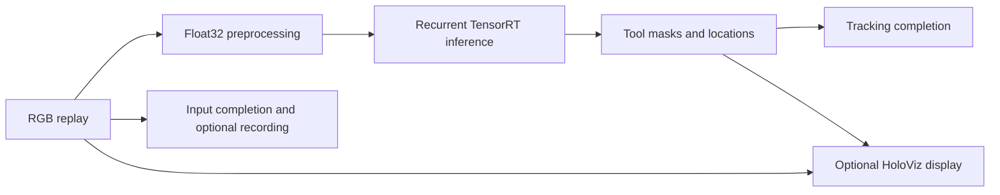

# Endoscopy Tool Tracking

This application replays surgical video and tracks seven tool classes using the
CAMMA convolutional LSTM model. It uses Holoscan SDK 5.x typed ports and
compose/compile/run APIs. All custom operators are in this application directory.



The initial migration includes C++ file replay, visualization, and optional input
recording. Python, capture-card integrations, alternative renderers, shader
variants, and GXF recording formats are outside this first application.

## Dependencies

- Linux on x86_64 or aarch64 with an NVIDIA GPU and a compatible driver.
- Holoscan SDK 5.x Core and Sensor I/O; use a `main-5x` SDK installation.
- Holoscan Visualization for display builds, exporting
  `holoscan::visualization::op_holoviz` and `<holoscan/visualization/holoviz_op.hpp>`.
- CMake 4.0+, a C++20 compiler, CUDA toolkit, and TensorRT 10 development libraries
  (`nvinfer`, `nvinfer_plugin`, `nvonnxparser`).
- Python 3.12–3.14 and the CLI pinned in the repository's
  [requirements.txt](../../requirements.txt) for repository workflows.
- FFmpeg for the one-time video conversion.

The application uses a small model-specific inference operator because its
recurrent cell/hidden states must persist between frames. The SDK supplies Core
and Visualization. HoloViz accepts the original RGB tensor directly. The C++
executable has no Python runtime dependency; Python is used by the CLI, tests,
and optional sample-preparation utility.

## Prepare the sample

Once, from the repository root, with FFmpeg installed on the host:

```bash
python3 applications/endoscopy_tool_tracking/prepare_data.py \
  --output data/endoscopy --frames 300
```

This downloads the pinned
[NGC endoscopy sample](https://catalog.ngc.nvidia.com/orgs/nvidia/teams/clara-holoscan/resources/holoscan_endoscopy_sample_data)
(version `20230222`), extracts the ONNX model and H.264 input, and converts the
video to contiguous 854×480 RGB24. The default limit is 300 frames (about 369 MB).
`--frames 0` converts the whole clip. Use `--archive /path/to/sample.zip` for an
existing download and `--force` to replace prepared assets or change the frame
limit. Existing valid assets are reused by default. A failed conversion leaves
previously prepared assets intact. Alternatively, supply an ONNX model and
RGB24 video directly. The application never downloads or converts data at runtime.

The model and sample video are provided by the Research Group CAMMA, IHU
Strasbourg, and the University of Strasbourg. Their terms are provided with the
NGC resource; they are downloaded separately from this source repository.

## Build and run

Install the repository tools as described in the repository
[Getting started](../../README.md#getting-started). Run the commands below from
the repository root.

### In a container

The CLI builds and runs in a container by default. Select the Holoscan SDK image:

```bash
export HOLOSCAN_CLI_BASE_IMAGE=nvcr.io/nvidia/clara-holoscan/holoscan:v5.0.0-cuda13
holoscan run endoscopy_tool_tracking replay
holoscan run endoscopy_tool_tracking headless
holoscan run endoscopy_tool_tracking ci
```

Add `--dryrun --verbose` to preview the image and the build and run commands.

### On the host

Install the [dependencies](#dependencies) on the host, select your SDK
installation, and add `--local`:

```bash
export HOLOSCAN_SDK_ROOT=/path/to/holoscan/install
holoscan run endoscopy_tool_tracking replay --local
```

### Modes and options

Every mode launches the C++ executable directly. `replay` and `headless` use the
prepared files in `data/endoscopy`; `ci` needs no sample data.

`replay` displays when an X11 or Wayland display is available, otherwise it runs
headless. To require a window, use `--run-args='--display true'`.

`ci` processes ten synthetic frames with inference explicitly disabled. This
mode implements the [shared CI contract](../../docs/ci.md); hosted CI validates
its build/run commands with dry runs and executes the SDK-free data-preparation
tests. The configured SDK job builds and runs this mode and the C++/CUDA tests.

Real tracking is enabled by default; a missing model is an error. TensorRT builds an
engine on first use. The cache is keyed by model contents, GPU, TensorRT version,
precision, and workspace settings. Invalid engines are rejected and rebuilt.
FP32 is the default because FP16 produced NaN predictions on GB10 / TensorRT
10.16. Invalid probabilities or coordinates fail the run instead of silently
producing empty overlays.

`--count 0` processes the entire prepared video once. `--repeat true` permits a
larger explicit count than the available video. Replay preserves order and applies
backpressure through inference. Completion waits for input consumption and both
tracking outputs; the optional display consumes the latest available frames.

Record the original input into a new directory:

```bash
holoscan run endoscopy_tool_tracking headless \
  --run-args='--count 30 --record-dir /workspace/holohub/data/endoscopy-recording'
```

The output is `data/endoscopy-recording/input.rgb` on the host, preserved through
the repository mount. With `--local`, use a host path instead. Existing recordings
are never overwritten. Use `--run-args='--help'` for model/cache paths, replay
timing, dimensions for synthetic tests, and timeout settings.

## Tests

The CLI supplies the repository's CTest driver; `holoscan test` takes no mode.
In a container, with `HOLOSCAN_CLI_BASE_IMAGE` selected:

```bash
holoscan test endoscopy_tool_tracking --no-xvfb \
  --cmake-options='-DENDOSCOPY_ENABLE_VISUALIZATION=ON;-DENDOSCOPY_DATA_DIR=/workspace/holohub/data/endoscopy'
```

For host tests, set `HOLOSCAN_SDK_ROOT`, add `--local`, and set
`ENDOSCOPY_DATA_DIR` to the host path.

The suite covers invalid arguments, truncated RGB streams, repeated replay,
recording byte fidelity, preservation of input files, data-preparation failures,
cache invalidation, malformed TensorRT engines, invalid model outputs, and CUDA
mask composition. When `ENDOSCOPY_DATA_DIR` is set, the real model test creates a
fresh engine, reuses it, and verifies recovery from a corrupt cache. That test
requires at least three prepared frames. GPU tests require CUDA even in a headless build.

Mask composition is deterministic and uses straight alpha for current HoloViz.
It preserves tool thresholds, palette, and coordinates but is not expected to be
pixel-identical to the older HoloHub premultiplied overlay.

The application was validated on aarch64 (GB10) with Holoscan SDK 5.0.0 at
`main-5x` commit `e5191121d`, CUDA 13.0, and TensorRT 10.16.1. Headless inference
and HoloViz rendering under Xvfb completed 300 real video frames. x86_64 and
native Wayland have not yet been exercised.

## Standalone build

As an advanced option, build and run the C++ executable without the CLI or
Python (tests disabled), using the SDK selected by `HOLOSCAN_SDK_ROOT`:

```bash
cmake -S applications/endoscopy_tool_tracking -B build/endoscopy-standalone \
  -Dholoscan_ROOT="$HOLOSCAN_SDK_ROOT" \
  -DCMAKE_CUDA_ARCHITECTURES=native \
  -DENDOSCOPY_ENABLE_VISUALIZATION=OFF \
  -DBUILD_TESTING=OFF
cmake --build build/endoscopy-standalone --parallel
./build/endoscopy-standalone/endoscopy_tool_tracking --data data/endoscopy --display false
```

Choose explicit CUDA architectures when building for other GPUs. Setting
`ENDOSCOPY_ENABLE_VISUALIZATION=OFF` removes the display dependency entirely.
