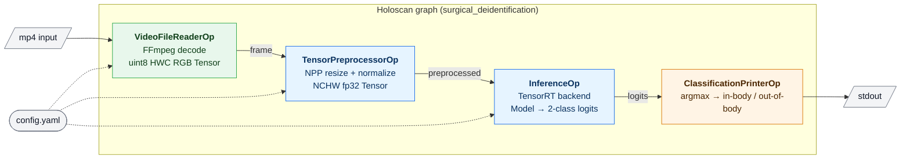

# Surgical De-identification Demo: In-body / Out-of-body Surgical-Video Classifier

An end-to-end Holoscan pipeline that reads a surgical procedure video, resizes and
normalizes each frame on the GPU, runs a binary classifier that labels the frame as `in-body`
or `out-of-body`, and prints the result to stdout.

## Overview

The application is a four-operator Holoscan graph. Each node below is one operator; the
edges carry the tensor emitted into the next operator's input port.



## Dataset download (CMake-driven)

The ONNX model and sample MP4 are fetched by CMake from the public
[NGC endoscopy_out_of_body_detection](https://catalog.ngc.nvidia.com/orgs/nvidia/teams/clara-holoscan/resources/endoscopy_out_of_body_detection)
resource. **Downloaded artifacts are subject to the NGC resource's own license and
terms of use** — see the [resource page](https://catalog.ngc.nvidia.com/orgs/nvidia/teams/clara-holoscan/resources/endoscopy_out_of_body_detection)
license tab and [NVIDIA AI Foundation Models Community License](https://developer.nvidia.com/downloads/nv-ai-foundation-models-license);
by invoking the download target you accept those terms.

> **Download integrity warning:** the fetched archive is verified with the SHA-256
> stored in `cmake/DownloadData.cmake` (`SURGICAL_DEID_NGC_SHA256`). If that value
> is empty, the download runs without integrity verification and a tampered or
> substituted archive could end up in the inference pipeline; populate it with the
> published SHA-256 before using the download target in untrusted environments.

Two ways:

- **Chain into the build** (one-shot): configure with `-DSURGICAL_DEID_DOWNLOAD_DATA=ON`
  and the `de_id` target depends on the download target, so the dataset lands as part
  of `holoscan build` / `cmake --build .`.
- **Fetch on demand**: `cmake --build <build-dir> --target de_id_download_data`.

Both drop the resource at `${HOLOHUB_DATA_DIR}/endoscopy_out_of_body_detection/`.
The CMake default is `<build>/data`; to align with the Holoscan CLI's default
`<repository>/data` layout (what the baked `config.yaml` expects to be mounted at
`/data` inside the container), configure with
`-DHOLOHUB_DATA_DIR=<repository>/data`. Pin a different NGC version with
`-DSURGICAL_DEID_NGC_VERSION=<ver>`. The e2e ctest picks the files up automatically
and no longer skips.

## Requirements

### Software

- **Holoscan SDK ≥ 5.0.0**. The shipped Dockerfile leaves `BASE_IMAGE` unset by design; the
  Holoscan CLI supplies it from `--base-img` or the `HOLOSCAN_CLI_BASE_IMAGE` environment
  variable (set below), so nothing further needs installing on the host.

### Model and Sample Data

The detection model and sample datasets are available on [NGC](https://catalog.ngc.nvidia.com/orgs/nvidia/teams/clara-holoscan/resources/endoscopy_out_of_body_detection). The package includes:

- Pre-trained ONNX model for out-of-body detection: `out_of_body_detection.onnx`
- Sample endoscopy video clips (MP4 format): `sample_clip_out_of_body_detection.mp4`

| Artifact     | Expected path on host                                                               |
|--------------|-------------------------------------------------------------------------------------|
| ONNX model   | `<data_root>/endoscopy_out_of_body_detection/out_of_body_detection.onnx`            |
| Sample video | `<data_root>/endoscopy_out_of_body_detection/sample_clip_out_of_body_detection.mp4` |

The paths above match the stock `config.yaml` after mounting `<data_root>` at `/data`
inside the container (see **Run** below). When the build is configured with
`-DHOLOHUB_DATA_DIR=<repository>/data -DSURGICAL_DEID_DOWNLOAD_DATA=ON` the CMake download
target places the resource at `<repository>/data/endoscopy_out_of_body_detection/`, matching
the Holoscan CLI's default data directory. Mount that directory at `/data` to run
end-to-end without copying files. Any other layout works too — just edit
`inference.model_path_map.de_id` and `video_source.path` in `config.yaml`.

## Quick Start Guide

```sh
# One-time: build the image and project, fetching the NGC dataset into <repository>/data/
# so the Holoscan CLI's default data directory lines up with the stock config.yaml.
holoscan build surgical_deidentification \
    --configure-args="-DHOLOHUB_DATA_DIR=$PWD/data -DSURGICAL_DEID_DOWNLOAD_DATA=ON"

# Each run: mount the dataset directory at /data and launch.
holoscan run surgical_deidentification \
    --docker-opts="-v $PWD/data:/data"
```

That's it — the baked `config.yaml` resolves paths under `/data/...` and the container runs
end-to-end.

## Build and Run Instructions

The application is built and run through the Holoscan CLI from the repository root.
The CLI uses the shipped [Dockerfile](./Dockerfile) (which installs this application's
apt dependencies on top of a Holoscan SDK 5.x base image) and the stock `config.yaml`
alongside the compiled `de_id` binary.

Install the pinned CLI and select the SDK image once per shell:

```sh
uv tool install --python 3.12 holoscan-cli==5.0.0
export HOLOSCAN_CLI_BASE_IMAGE=nvcr.io/nvidia/clara-holoscan/holoscan:v5.0.0-cuda13
```

### Build

```sh
holoscan build surgical_deidentification
```

For a local (no-Docker) build, install the apt dependencies listed in
[`metadata.json`](./metadata.json) (`libav{format,codec,util}-dev`, `libswscale-dev`,
`libyaml-cpp-dev`), point `HOLOSCAN_SDK_ROOT` at a compatible SDK installation, and run:

```sh
export HOLOSCAN_SDK_ROOT=/path/to/holoscan/install
holoscan build surgical_deidentification --local
```

### Run

Mount the CMake-populated dataset directory at `/data` inside the container; the stock
`config.yaml` expects model and video paths rooted there. The Quick Start step above
places the dataset at `<repository>/data/endoscopy_out_of_body_detection/` (the Holoscan
CLI's default data directory), so mount `<repository>/data` at `/data`:

```sh
holoscan run surgical_deidentification \
    --docker-opts="-v $PWD/data:/data"
```

#### Expected output

After the TensorRT engine builds on first run, the pipeline prints:

```text
[info] Engine file missing at /data/endoscopy_out_of_body_detection/out_of_body_detection.<...>.engine.fp16. Starting generation process.
[info] Engine generation completed in 5.867 seconds.
frame 1: Likely in-body (confidence=0.9873)
frame 2: Likely in-body (confidence=0.9821)
frame 3: Likely out-of-body (confidence=0.6412)
...

InferenceTiming (steady-state, warmup=10 ticks skipped):
  samples : 89
  min ms  : 16.3
  mean ms : 19.2
  p50 ms  : 18.1
  p99 ms  : 29.7
  max ms  : 31.5
```

#### Command-line options

The CLI forwards everything after `--run-args` straight to the `de_id` binary.

| Flag                   | Default                                                        | Meaning                                                                                     |
|------------------------|----------------------------------------------------------------|---------------------------------------------------------------------------------------------|
| `--config <path.yaml>` | `<holohub_app_bin>/config.yaml` (shipped alongside the binary) | Path to the YAML configuration file.                                                        |
| `--ticks <N>`          | `0` (unbounded — runs until EOF)                               | Stop after `N` sink activations. Useful for benchmarking.                                   |
| `--self-test`          | (off)                                                          | Load dynamic libraries, print `de_id self-test ok`, exit 0.                                 |
| `--ci-ticks <N>`       | (off)                                                          | Run a bounded synthetic reader-only pipeline for N ticks. Used by the metadata `ci` mode.   |

Examples:

```sh
# Benchmark: cap at 500 ticks.
holoscan run surgical_deidentification \
    --docker-opts="-v $PWD/data:/data" \
    --run-args="--ticks 500"

# Try an edited config without touching the checkout — mount it over the installed one.
holoscan run surgical_deidentification \
    --docker-opts="-v $PWD/data:/data -v $PWD/my_overrides.yaml:/workspace/bin/config.yaml:ro"
```

## Configuration

`config.yaml` is a single YAML document consumed by the application's YAML loader. The
relevant knobs:

- `inference.model_path_map.de_id` — absolute path to `out_of_body_detection.onnx` inside
  the container, under the CMake-populated dataset directory
  (`/data/endoscopy_out_of_body_detection/`).
- `inference.input_map` / `output_map` — tensor names bridging the preprocessor to the
  classifier head. The defaults match the shipped `out_of_body_detection.onnx`.
- `preprocessor.output_width`, `output_height`, `output_pix_fmt`, `output_layout`,
  `normalize_mean`, `normalize_std` — standard `TensorPreprocessorOp` knobs; see the
  SDK's tensor_preprocessor README for the full menu.
- `video_source.path` — absolute path to the input `.mp4` inside the container.
- `video_source.loop`, `frame_count`, `frame_rate` — reader-side pacing knobs; the stock
  config sets `loop: true` and `frame_count: 0` so the pipeline runs until stopped.

The CLI ships `config.yaml` alongside the installed `de_id` binary. To swap in a
different config without rebuilding, mount it over the installed one at run time as
shown in the examples above, or edit `config.yaml` in the checkout and rebuild.

## Tests and CI

The application ships three tiers of tests, registered with CTest. The tier that runs depends
on how the project is configured.

| Tier               | Count | Needs Holoscan SDK | Needs NGC dataset | Label           |
|--------------------|------:|--------------------|-------------------|-----------------|
| YAML / schema unit |    24 | yes                | no                | `cpu;unit`      |
| Operator runtime   |     5 | yes                | no                | `gpu;runtime`   |
| de_id binary smoke |     1 | yes                | no                | `cpu;smoke`     |
| de_id binary e2e   |     1 | yes                | yes               | `gpu;functional`|

Running `ctest` against a full build (`HOLOHUB_BUILD_CPP=ON -DBUILD_TESTING=ON
-DSURGICAL_DEID_DOWNLOAD_DATA=ON`) exercises all 31 tests, including a real TensorRT inference
pass over the NGC `endoscopy_out_of_body_detection` model and clip. Without the dataset, the
e2e test returns CTest's skip code (`77`) and the remaining 30 still run.

Hosted CI (`HOLOHUB_BUILD_CPP=OFF -DBUILD_TESTING=ON`) skips the `de_id` binary (both the smoke
and the e2e test) and runs the 29 CPU / runtime operator tests (24 YAML + 5 runtime) directly
from the top-level `CMakeLists.txt`. If the Holoscan SDK is not installed on the runner, the
block is skipped entirely with a `message(STATUS …)` note and configure still succeeds.

The `ci` run mode registered in `metadata.json` invokes `de_id --ci-ticks 5`: it encodes a
short synthetic MP4 in-process and drives `VideoFileReaderOp` through a drop-sink pipeline for
five frames, exiting non-zero if the sink receives fewer than requested.

## Compliance and codec licensing

This application distributes **source code only** and depends on third-party video codecs
through [FFmpeg](https://ffmpeg.org/) (`libavformat`, `libavcodec`, `libavutil`,
`libswscale`). The source distribution itself does not incur royalty or licensing
obligations, but downstream users who build on this application as a template — in
particular, those who distribute binaries, operate it commercially, or ship it as part of
a product — should review the licensing of the specific codecs and container formats they
end up using.

### Codecs and container formats touched by this application

The following codecs can be invoked at runtime depending on the input / output configuration
chosen by the user:

| Operator            | Direction | Codec / format                                                                                                                                        | Patent-pool status (non-legal summary)                                                            |
|---------------------|-----------|-------------------------------------------------------------------------------------------------------------------------------------------------------|---------------------------------------------------------------------------------------------------|
| `VideoFileReaderOp` | Decode    | H.264 / MPEG-4 Part 10 (AVC)                                                                                                                          | MPEG-LA AVC patent pool. Royalty-bearing for commercial encoders and some distribution scenarios. |
|                     | Decode    | H.265 / MPEG-H Part 2 (HEVC)                                                                                                                          | Multiple patent pools (MPEG-LA, Access Advance, Velos Media). Royalty-bearing.                    |
|                     | Decode    | MPEG-4 Visual, VP9, AV1, MJPEG, raw YUV, and any other codec supported by the host FFmpeg build                                                       | Varies — AV1 is royalty-free, VP9 effectively so, MPEG-4 Visual is patent-pool.                   |
| `VideoFileWriterOp` | Encode    | `mpeg4` (MPEG-4 Visual Part 2) by default (ships with every FFmpeg build). Set `codec` to libx264/libx265/mjpeg/ffv1 (needs that encoder in FFmpeg).  | mpeg4 is MPEG-4 Visual patent-pool; alternatives are royalty-bearing where their codecs are.      |
| Container           | Both      | MPEG-4 Part 14 (`.mp4`) and any other container supported by FFmpeg                                                                                   | ISO/IEC base media file format — MPEG-4 Systems patent pool applies to some uses.                 |

### FFmpeg library licensing

Build-time dependencies (`libavformat-dev`, `libavcodec-dev`, `libavutil-dev`,
`libswscale-dev`) are installed from the host OS distribution. Standard FFmpeg builds are
distributed under the **LGPL v2.1 or later** by default; builds configured with
`--enable-gpl` are **GPL v2 or later**. Downstream users should verify the licensing
terms of the FFmpeg binary they actually link against (e.g. the one in their container
base image).

### Downstream recommendations

- **Source distribution** (this repository): no additional obligation — IP and license
  review is the responsibility of the party that compiles and distributes a binary.
- **Binary distribution** derived from this application: evaluate (a) the FFmpeg LGPL/GPL
  obligations, and (b) codec patent licensing for every codec that could run through
  `VideoFileReaderOp` or `VideoFileWriterOp` in the deployed configuration.
- **Commercial deployment**: consult the relevant patent pools (MPEG-LA, Access Advance,
  Via Licensing, etc.) for the codecs actually used; royalty-free codecs such as AV1 may
  simplify the compliance story.
