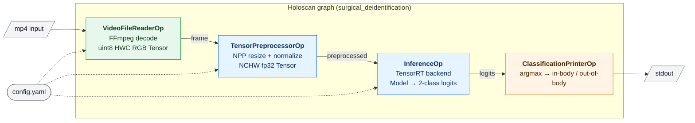

# Surgical De-identification Demo: In-body / Out-of-body Surgical-Video Classifier

A end-to-end Holoscan pipeline that reads a surgical procedure video, resizes and
normalizes each frame on the GPU, runs a binary classifier that labels the frame as `in-body`
or `out-of-body`, and prints the result to stdout.

## Overview

The application is a four-operator Holoscan graph. Each node below is one operator; the
edges carry the tensor emitted into the next operator's input port.



## Dataset download (CMake-driven)

The ONNX model and sample MP4 are fetched by CMake from the public
[NGC endoscopy_out_of_body_detection](https://catalog.ngc.nvidia.com/orgs/nvidia/teams/clara-holoscan/resources/endoscopy_out_of_body_detection)
resource. Two ways:

- **Chain into the build** (one-shot): configure with `-DSURGICAL_DEID_DOWNLOAD_DATA=ON`
  and the `de_id` target depends on the download target, so the dataset lands as part
  of `holoscan build` / `cmake --build .`.
- **Fetch on demand**: `cmake --build <build-dir> --target de_id_download_data`.

Both drop the resource at `${HOLOHUB_DATA_DIR}/endoscopy_out_of_body_detection/`
(default `<build>/data/endoscopy_out_of_body_detection/`). Override the location with
`-DHOLOHUB_DATA_DIR=/path/on/host` and the pinned version with
`-DSURGICAL_DEID_NGC_VERSION=<ver>`. The e2e ctest picks the files up automatically
and no longer skips.

## Requirements

### Software

- **Holoscan SDK ≥ 5.0.0**. The baked Dockerfile pulls a Holoscan SDK 5.x container from
  NGC; nothing further to install on the host.

### Model and Sample Data

The detection model and sample datasets are available on [NGC](https://catalog.ngc.nvidia.com/orgs/nvidia/teams/clara-holoscan/resources/endoscopy_out_of_body_detection). The package includes:

- Pre-trained ONNX model for out-of-body detection: `out_of_body_detection.onnx`
- Sample endoscopy video clips (MP4 format): `sample_clip_out_of_body_detection.mp4`

| Artifact           | Expected path on host                                    |
|--------------------|----------------------------------------------------------|
| ONNX model         | `<data_root>/de_id/model/<model_name>.onnx`              |
| Sample video       | `<data_root>/de_id/video/outbody/<file_name>.mp4`        |

The paths above match the stock `config.yaml` after mounting `<data_root>` at `/data`
inside the container (see **Run** below). Any other layout works too — just edit the
`model_path_map` and `video_path` entries in `config.yaml`.

## Quick Start Guide

```sh
# One-time: build the image and project.
holoscan build surgical_deidentification

# Each run: mount your dataset and launch.
holoscan run surgical_deidentification \
  --docker-opts="-v <host/path/to/data>:/data"
```

That's it — the baked `config.yaml` resolves paths under `/data/...` and the container runs
end-to-end.

## Build and Run Instructions

The application is built and run through the Holoscan CLI from the repository root.
The CLI uses the shipped [Dockerfile](./Dockerfile) (which installs this application's
apt dependencies on top of a Holoscan SDK 5.x base image) and the stock `config.yaml`
alongside the compiled `de_id` binary.

Install the pinned CLI and select the SDK image once per shell:

```sh
uv tool install --python 3.12 holoscan-cli==5.0.0
export HOLOSCAN_CLI_BASE_IMAGE=nvcr.io/nvidia/clara-holoscan/holoscan:v5.0.0-cuda13
```

### Build

```sh
holoscan build surgical_deidentification
```

For a local (no-Docker) build, install the apt dependencies listed in
[`metadata.json`](./metadata.json) (`libav{format,codec,util}-dev`, `libswscale-dev`,
`libyaml-cpp-dev`), point `HOLOSCAN_SDK_ROOT` at a compatible SDK installation, and run:

```sh
export HOLOSCAN_SDK_ROOT=/path/to/holoscan/install
holoscan build surgical_deidentification --local
```

### Run

Mount your dataset directory at `/data` inside the container; the stock `config.yaml`
expects model and video paths rooted there.

```sh
holoscan run surgical_deidentification \
    --docker-opts="-v $HOME/data:/data"
```

#### Expected output

After the TensorRT engine builds on first run, the pipeline prints:

```
[info] Engine file missing at /data/de_id/model/de_id.<...>.engine.fp16. Starting generation process.
[info] Engine generation completed in 5.867 seconds.
in-body
in-body
out-of-body
...
Summary: 100 ticks in 2318.4 ms
Per-tick delta (µs) — samples=94 (post-warmup)
  min=16.3 p50=18.1 mean=19.2 p90=22.4 p95=24.0 p99=29.7 max=31.5 stddev=2.1
```

#### Command-line options

The CLI forwards everything after `--run-args` straight to the `de_id` binary.

| Flag                     | Default                              | Meaning                                                   |
|--------------------------|--------------------------------------|-----------------------------------------------------------|
| `--config <path.yaml>`   | `<holohub_app_bin>/config.yaml` (shipped alongside the binary) | Path to the YAML configuration file. |
| `--ticks <N>`            | `0` (unbounded — runs until EOF)     | Stop after `N` sink activations. Useful for benchmarking. |

Examples:

```sh
# Benchmark: cap at 500 ticks.
holoscan run surgical_deidentification \
    --docker-opts="-v $HOME/data:/data" \
    --run-args="--ticks 500"

# Try an edited config without touching the checkout — mount it over the installed one.
holoscan run surgical_deidentification \
    --docker-opts="-v $HOME/data:/data -v $PWD/my_overrides.yaml:/workspace/bin/config.yaml:ro"
```

## Configuration

`config.yaml` is a single YAML document consumed by the application's YAML loader. The
relevant knobs:

- `inference.model_path_map.de_id` — absolute path to `de_id.onnx` inside the container.
  Must point under the dataset mount.
- `inference.input_map` / `output_map` — tensor names bridging the preprocessor to the
  classifier head. The defaults match the shipped `de_id.onnx`.
- `preprocessor.input_pix_fmt`, `output_width`, `output_height`,
  `normalize_mean`, `normalize_std` — standard `TensorPreprocessorOp` knobs; see the
  SDK's tensor_preprocessor README for the full menu.
- `reader.video_path` — absolute path to the input `.mp4` inside the container.

The CLI ships `config.yaml` alongside the installed `de_id` binary. To swap in a
different config without rebuilding, mount it over the installed one at run time as
shown in the examples above, or edit `config.yaml` in the checkout and rebuild.

## Compliance and codec licensing

This application distributes **source code only** and depends on third-party video codecs
through [FFmpeg](https://ffmpeg.org/) (`libavformat`, `libavcodec`, `libavutil`,
`libswscale`). The source distribution itself does not incur royalty or licensing
obligations, but downstream users who build on this application as a template — in
particular, those who distribute binaries, operate it commercially, or ship it as part of
a product — should review the licensing of the specific codecs and container formats they
end up using.

### Codecs and container formats touched by this application

The following codecs can be invoked at runtime depending on the input / output configuration
chosen by the user:

| Operator                | Direction | Codec / format      | Patent-pool status (non-legal summary) |
|-------------------------|-----------|---------------------|-----------------------------------------|
| `VideoFileReaderOp`     | Decode    | H.264 / MPEG-4 Part 10 (AVC) | MPEG-LA AVC patent pool. Royalty-bearing for commercial encoders and some distribution scenarios. |
|                         | Decode    | H.265 / MPEG-H Part 2 (HEVC) | Multiple patent pools (MPEG-LA, Access Advance, Velos Media). Royalty-bearing. |
|                         | Decode    | MPEG-4 Visual, VP9, AV1, MJPEG, raw YUV, and any other codec supported by the host FFmpeg build | Varies — AV1 is royalty-free, VP9 effectively so, MPEG-4 Visual is patent-pool. |
| `VideoFileWriterOp`     | Encode    | Whatever codec its config selects (defaults to the FFmpeg encoder matching the output container; typically H.264 for `.mp4`) | Same pools as the decode side; encoding generally has stricter royalty terms than decoding. |
| Container               | Both      | MPEG-4 Part 14 (`.mp4`) and any other container supported by FFmpeg | ISO/IEC base media file format — MPEG-4 Systems patent pool applies to some uses. |

### FFmpeg library licensing

Build-time dependencies (`libavformat-dev`, `libavcodec-dev`, `libavutil-dev`,
`libswscale-dev`) are installed from the host OS distribution. Standard FFmpeg builds are
distributed under the **LGPL v2.1 or later** by default; builds configured with
`--enable-gpl` are **GPL v2 or later**. Downstream users should verify the licensing
terms of the FFmpeg binary they actually link against (e.g. the one in their container
base image).

### Downstream recommendations

- **Source distribution** (this repository): no additional obligation — IP and license
  review is the responsibility of the party that compiles and distributes a binary.
- **Binary distribution** derived from this application: evaluate (a) the FFmpeg LGPL/GPL
  obligations, and (b) codec patent licensing for every codec that could run through
  `VideoFileReaderOp` or `VideoFileWriterOp` in the deployed configuration.
- **Commercial deployment**: consult the relevant patent pools (MPEG-LA, Access Advance,
  Via Licensing, etc.) for the codecs actually used; royalty-free codecs such as AV1 may
  simplify the compliance story.
