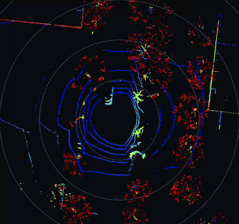
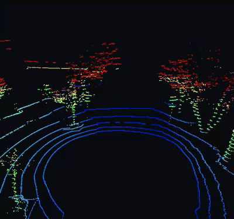
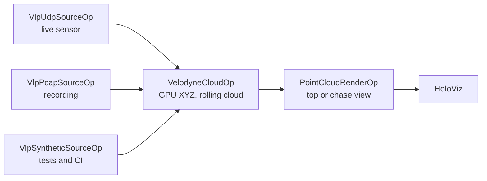

# Velodyne VLP-16 Lidar Viewer

This application receives Velodyne VLP-16 lidar packets, converts them to a rolling
Cartesian point cloud on the GPU, and displays the cloud from a fixed top-down or
chase camera. It supports live UDP, recorded pcap, and synthetic input with
Holoscan SDK 5.x. All operators are in this application directory.

Top view of a highway recording:



Chase view of a highway recording:





Each run uses one of three interchangeable sources. They all emit the same
batch of 1206-byte packets, so the rest of the graph is unchanged.

## Requirements

- Linux on x86_64 or aarch64 with an NVIDIA GPU and a compatible driver.
- Holoscan SDK 5.x Core and Sensor I/O, plus Holoscan Visualization for display builds.
- CMake 4.0+, a C++20 compiler, and the CUDA toolkit.
- Python 3.12–3.14 and the CLI pinned in the repository's
  [requirements.txt](../../requirements.txt) for repository workflows.
- A packet source: a VLP-16 sensor, or a VLP-16 `.pcap` recording such as the
  samples in Kitware's [VeloView collection](https://www.paraview.org/veloview/#download).
  No sensor? `make_pcap.py` writes a synthetic recording.

## Build and run

Install the pinned CLI and select your SDK and matching development image once per
shell, as described in the [repository README](../../README.md). From the repository root:

```bash
holoscan run velodyne_lidar live       # VLP-16 on UDP port 2368
holoscan run velodyne_lidar live-close # live sensor, close chase view
holoscan run velodyne_lidar replay     # data/velodyne/recording.pcap, looped
holoscan run velodyne_lidar synthetic  # endless synthetic sweep, no sensor or data
holoscan run velodyne_lidar ci         # synthetic packets, headless, finite
```

Use `--local` to build and run on the host. Pass application options with
`--run-args`, for example `--run-args='--view chase'`; `--run-args='--help'` lists them all.

### Live sensor

Connect the VLP-16 and configure the host interface for the sensor's network as
described in the [VLP-16 user manual](https://data.ouster.io/downloads/velodyne/user-manual/vlp-16-user-manual-revf.pdf).
By default the sensor broadcasts data packets from 192.168.1.201 to UDP port 2368.
The sensor needs about 30 seconds after power-on before it sends packets.

Live mode binds `0.0.0.0:2368`, which listens on every network interface.
To listen only on the interface connected to the sensor, pass its address:

```bash
holoscan run velodyne_lidar live --run-args='--address 192.168.1.100'
```

Any host that can reach the port can send packets to the viewer. Datagrams that
are not well-formed VLP-16 packets are counted and dropped. Prefer `--address`
and a host firewall rule on shared networks; see [SECURITY.md](../../SECURITY.md).
When running in a container, the container must be able to receive the
sensor's UDP traffic (for example, through host networking), or run with `--local`.

### Replay a recording

`replay` reads `data/velodyne/recording.pcap` from the repository root. No sample
is bundled or downloaded, so supply one first:

1. Download a VLP-16 sample recording from Kitware's
   [VeloView collection](https://www.paraview.org/veloview/#download), and
   review its terms there. Pick a VLP-16 (Puck) recording. Packets with model byte
   `0x22` or `0x21` are decoded as VLP-16, because some VLP-16 recordings, including
   the VeloView samples, report `0x21`. Velodyne also uses `0x21` for the HDL-32E,
   which is not supported and would draw with the wrong laser angles. Other models
   are skipped.
2. If the file is pcapng, convert it to classic pcap with Wireshark's `editcap`:
   `editcap -F pcap input.pcapng recording.pcap`.
3. Put the file at `data/velodyne/recording.pcap` and run
   `holoscan run velodyne_lidar replay`. With the binary, pass any path with `--pcap FILE`.

No sample at hand? `make_pcap.py` writes a synthetic one:

```bash
python3 applications/velodyne_lidar/make_pcap.py data/velodyne/recording.pcap
```

Replay keeps the recorded packet timing and skips frames that are not VLP-16 data
packets sent to `--port` (default 2368); the final summary line reports the
skipped count as `invalid=`. If `packets=0`, check the sensor model and port.

To see what a recording contains, run `vlp_inspect.py`. It reports the UDP ports,
model and return-mode bytes, and whether the packet timing matches a VLP-16 (about
754 data packets/s) or an HDL-32E (about 1808/s):

```bash
python3 applications/velodyne_lidar/vlp_inspect.py data/velodyne/recording.pcap
```

`tcpdump -nn -r FILE -c 5 'udp dst port 2368'` gives a quick look at the packets too.

### Views

The SDK 5.x HoloViz operator shows images and 2D geometry layers. There is no
interactive 3D point-cloud layer, so `PointCloudRenderOp` draws the cloud into an
RGBA image on the GPU, colored by height, from a fixed camera:

- `--view top` (default): plan view centered on the sensor, with range rings every
  10 m. `--range-m` sets the distance from the center to the edge (default 30).
- `--view chase`: perspective view from `--eye` toward `--target` (meters, default
  `0,-14,7` and `0,6,0`; +y is the sensor's 0° azimuth). `--orbit-deg-per-s`
  slowly rotates the eye around the target.

For nearby live testing, use `holoscan run velodyne_lidar live-close`. This preset
uses `--view chase --eye 0,-2,1 --target 0,0,0 --fov-deg 60 --point-size 3`,
placing the camera about 2.2 m from the sensor and looking at its origin.
Override individual settings with `--run-args`, for example:

```bash
holoscan run velodyne_lidar live-close --run-args='--eye 0,-1,0.5'
```

`--range-m` only changes top-view framing; it neither zooms the chase camera nor
filters returns by distance. In chase view, move `--eye` closer to `--target` or
reduce `--fov-deg` to zoom in. The default chase pose is 14 m behind and 7 m above
the sensor, looking 6 m ahead.

The window cannot be rotated with the mouse. `--packet-buffer-size` sets how many
packets the rolling cloud keeps (default 80, about one revolution at 10 Hz).

## Standalone build

Build and run the C++ executable without the CLI:

```bash
cmake -S applications/velodyne_lidar -B build/velodyne \
  -Dholoscan_ROOT="$HOLOSCAN_SDK_ROOT" -DBUILD_TESTING=OFF
cmake --build build/velodyne --parallel
./build/velodyne/velodyne_lidar --pcap data/velodyne/recording.pcap
```

CUDA code is built for the GPU in the build machine (`native`). To build for other
GPUs, or on a machine without one, list their architectures, for example
`-DCMAKE_CUDA_ARCHITECTURES="87;110"`. With the CLI, pass the same option through
`--configure-args='-DCMAKE_CUDA_ARCHITECTURES=87;110'`.
`-DVELODYNE_ENABLE_VISUALIZATION=OFF` removes the display dependency.

## Tests

```bash
holoscan test velodyne_lidar --no-xvfb
```

The suite covers packet validation and decoding, the pcap reader (including
non-lidar traffic), all three source operators in host-only graphs (the UDP test
sends packets over loopback), invalid arguments, the CUDA decoder against the host
reference, and headless synthetic and pcap runs that render both views. GPU tests
are skipped on machines without a GPU. The SDK-free pcap fixture tests also run in
hosted CI.

## How it works

1. A source emits batches of up to 64 VLP-16 data packets (1206 bytes, 384 laser
   returns each). The UDP source's receive thread queues packets and wakes the
   operator through a `NotificationSender`, following the SDK's
   `notification_bridge` example.
2. `VelodyneCloudOp` copies each batch to the GPU and converts the returns from
   spherical to Cartesian coordinates in a rolling device buffer. All work runs
   on the runtime's CUDA stream. Each batch emits a snapshot of the buffer.
3. `PointCloudRenderOp` renders the newest snapshot at display rate (`--render-period-ms`,
   default 33).

The packet decoder is adapted from the NVIDIA DeepMap SDK. This release adds
azimuth interpolation for the second firing sequence of each block.

## Changes from the Holoscan SDK 2.x/4.x release

The earlier application sources are available in the
[HoloHub archive-4x branch](https://github.com/nvidia-holoscan/holohub/tree/archive-4x/applications/velodyne_lidar_app).

- DAQIRI is no longer required; live mode uses a standard UDP socket.
- The YAML configuration is replaced by command-line options.
- The 3D HoloViz point layer is replaced by fixed top-down and chase views.
- The earlier latency benchmarks no longer apply and have not been repeated.

## Acknowledgements

This application was developed in part with support from the NVIDIA nvMap team
and adapts portions of the NVIDIA DeepMap SDK.
